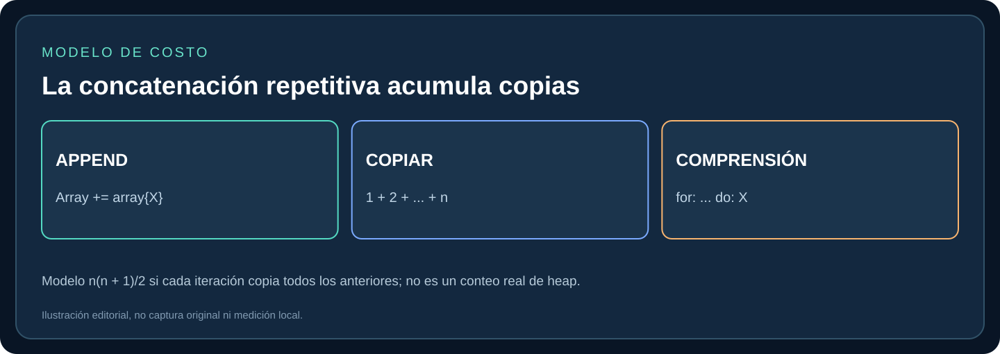
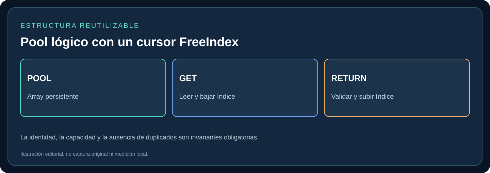
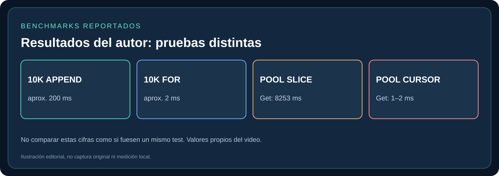
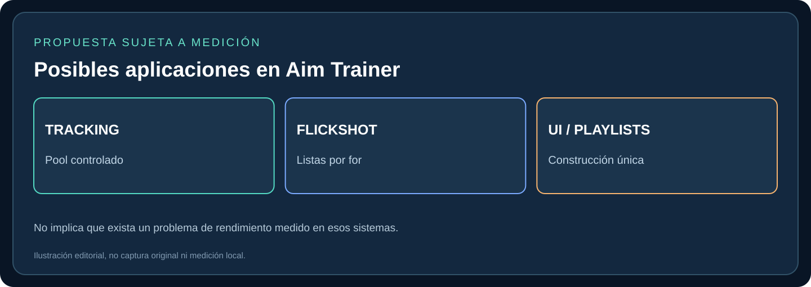

# Arrays hasta 100× más rápidos: construcción, copias y reutilización

> **Propósito para agentes.** Traducir una demostración de optimizaciones de arrays en Verse en reglas seguras y verificables, sin afirmar que estas mejoras ya se implementaron o midieron en el Aim Trainer. **[VIDEO]** indica afirmación o medición del creador; **[EPIC]** documentación oficial; **[ANÁLISIS]** inferencia técnica; **[PROPUESTA]** aplicación futura; **[PENDIENTE]** no verificado localmente.

[Índice del tema](../README.md) · [Evidencias](../assets/README.md) · [Procedencia](../sources/README.md)

## 1. Resumen ejecutivo y tres técnicas

1. **Construir arrays mediante una expresión `for` (array comprehension)** cuando deba generarse un resultado a partir de muchos valores: evita `set Array += array{Elemento}` dentro del ciclo. **[VIDEO] [EPIC]**.
2. **Evitar eliminar físicamente el último elemento con `Slice` en cada extracción** de un pool grande: el resultado es un array nuevo y, repetido muchas veces, puede producir costos elevados. **[VIDEO] [EPIC]**.
3. **Usar un cursor `FreeIndex` sobre almacenamiento reutilizable** si el conjunto es un pool cerrado, las reglas de pertenencia están controladas y las validaciones de ocupación lo permiten. **[VIDEO] [ANÁLISIS]**.

La frase **100×** procede de una comparación puntual anunciada en el video (aprox. 200 ms contra aprox. 2 ms al construir 10 000 valores). **No es un factor fijo** para todo array, toda versión de UEFN o todos los dispositivos.

## 2. Por qué agregar un elemento puede ser caro

El ejemplo de un `guard_pool_device` itera los Guard Spawners encontrados por tag, suscribe eventos y concatena `array{Spawner}` a `FreeSpawners`. Este patrón produce repetidamente nuevos valores de array. **[VIDEO] 0:46–1:12**.

```verse
# Patrón del autor: evitar en ciclos voluminosos.
set FreeSpawners += array{Spawner}
```



Si en cada ampliación se copian los elementos existentes, la cantidad acumulada para `n` inserciones es `1+2+...+n = n(n+1)/2`, que crece como **O(n²)** en este modelo. No equivale a afirmar que todas esas copias siguen vivas simultáneamente en memoria ni a conocer las optimizaciones internas del compilador. **[ANÁLISIS]**.

### Alternativa: comprender / construir una sola vez

```verse
# Ilustración basada en la forma usada por el autor.
set FreeSpawners += for:
    MaybeDevice : FindCreativeObjectsWithTag(device_tag{})
    Spawner := guard_spawner_device[MaybeDevice]
do:
    Spawner.EliminatedEvent.Subscribe(OnEliminated)
    Spawner.SpawnedEvent.Subscribe(OnSpawned)
    Spawner
```

El bloque `for` devuelve un array formado por el resultado de cada iteración. En la captura original el autor conserva las suscripciones y devuelve `Spawner` al final; **si `FreeSpawners` está vacío y solo se necesita construirlo una vez, preferir `set FreeSpawners = for: ... do: ...`** para evitar también la concatenación inicial. El fragmento es una **transcripción técnica aproximada** de la captura, no código validado compilando aquí. **[VIDEO] 1:55–2:37 [EPIC]**.

**Consideraciones:** si hay elementos preexistentes que deben permanecer, el `+=` final tiene una función distinta del `=`. En una comprensión con `if` / `else`, asegurar que cada rama produzca el mismo tipo esperado y mantener el comportamiento de suscripciones. **[VIDEO] 2:45–3:33**.

## 3. Demostración de 10 000 elementos

En el dispositivo ilustrativo `many_elements_device`, la captura muestra anotaciones cercanas a **200 ms** para concatenaciones iterativas de 10 000 valores y **2 ms** para la creación con comprensión. La razón aproximada de **100×** es válida solo como lectura de ese ejemplo. No contamos con hardware, build exacta, dispersión de muestras ni metodología reproducible completa. **[VIDEO] 3:38–3:48**.

```verse
# Variante A, comparador del video
for (Index := 1..NumberOfElements):
    set Array += array{Index}

# Variante B, resultado de una expresión for
set Array = for (Index := 1..NumberOfElements) do Index
```

**Interpretación:** evitar construir una colección mediante miles de concatenaciones repetidas; no extrapolar a todos los casos de actualización de un array.

## 4. Pool: por qué `Slice` no era suficiente

El segundo experimento usa `fake_pool_device`, con un arreglo inicial de valores disponibles y ciclos de **1000 extracciones / 1000 devoluciones**. **[VIDEO] 3:56–4:17**.

```verse
# Patrón original de extracción que reconstruye el array
GetElement()<transacts><decides>:int=
    Element := FreeElements[FreeElements.Length - 1]
    set FreeElements = FreeElements.Slice[0, FreeElements.Length - 1]
    return Element

# Patrón original de devolución
ReturnElement(Element:int):void=
    set FreeElements += array{Element}
```

**[EPIC]** `Slice` devuelve un array que contiene el segmento indicado. El rango de `Slice[0,Length-1]` **excluye** el límite final (elimina el último elemento si `Length ≥ 1`), y requiere un contexto válido para una operación que puede fallar. La sintaxis mostrada es la interpretada de capturas, no ejemplo certificado en ejecución.

### Medición del video: método inicial

| Prueba mostrada | Tiempo | Evidencia |
|---|---:|---|
| Extracciones (lote) | **8253,2273 ms** | Captura 10 |
| Devoluciones (lote) | **89,4410 ms** | Captura 10 |
| Extracciones, repetición | **8166,5438 ms** | Captura 10 |
| Devoluciones, repetición | **91,5879 ms** | Captura 10 |

**[VIDEO] 4:17–4:30**. Es un resultado de benchmark concreto, no garantía en otras sesiones.

El autor reemplaza luego `Slice` por una comprensión `for` que construye los elementos restantes; anuncia una reducción de aproximadamente **5 segundos** para la prueba, pero **todavía tarda cerca de 3 segundos** por las reconstrucciones repetidas. **[VIDEO] 4:30–5:04**. No se muestran en el material adjunto logs numéricos completos de esta variante intermedia.

## 5. Pool con índice: evitar asignaciones repetitivas

La mejora estructural conserva el array de almacenamiento y mueve un índice lógico (`FreeIndex`). En la captura 12 se aprecia la lógica de extracción: leer `FreeElements[FreeIndex]` y luego decrementar el cursor. **[VIDEO] 5:24–5:32**.



**Modelo de pila LIFO [ANÁLISIS], expresado como pseudocódigo NO compilable:**

```text
storage = conjunto de elementos precreados
freeIndex = length(storage) - 1

get():
    verificar freeIndex >= 0
    element = storage[freeIndex]
    freeIndex -= 1
    marcar element como prestado
    return element

return(element):
    verificar pertenencia, no duplicidad y espacio
    freeIndex += 1
    storage[freeIndex] = element
    marcar element como disponible
```

**Precaución crítica:** el archivo original **no incluye una captura legible del código completo del `ReturnElement` final**. La operación de devolución anterior es una **propuesta general de diseño** que debe adaptarse y validarse, no una transcripción que pueda atribuirse al autor. En Verse también deben revisarse las reglas de acceso failable y de efectos (`<decides>`, `<transacts>`).

### Invariantes que deben cumplirse

- `-1 <= FreeIndex < Storage.Length`, con `-1` indicando un pool vacío.
- Si se devuelve un elemento: pertenece al pool, estaba prestado, no está duplicado en las posiciones disponibles.
- Nunca se incrementa más allá de la capacidad ni se extrae con índice negativo.
- La devolución debe **restablecer el valor correcto** en el slot disponible cuando el orden / identidad pueda cambiar.
- Los eventos asíncronos del NPC no deben devolver el mismo objeto dos veces; manejar cancelaciones y destrucciones.
- Un pool no es una estructura adecuada si cada actualización requiere insertar elementos arbitrarios o mantener orden estable sin gestionar esas restricciones.

### Medición del video: variante basada en cursor

El log final (captura 13) muestra varias ejecuciones de extracción con tiempos cercanos a **1,49–1,77 ms** y devolución alrededor de **1,99–2,20 ms** para el lote de prueba. La cifra “8 segundos a 1–2 milisegundos” **compara implementaciones concretas del autor**, no es un factor universal ni una prueba ejecutada aquí. **[VIDEO] 7:12–7:35**.



## 6. Aplicación propuesta al Aim Trainer



| Subsistema | Posible mejora | Riesgos a revisar |
|---|---|---|
| **NPC Spawner / Tracking** | Pool de referencias reutilizables para objetivos, solo si lifecycle permite devolución fiable | Eliminaciones, doble retorno, slots invalidados, spawners destruidos |
| **Flickshot / Switching** | Generar listas de posiciones o referencias con `for` en vez de concatenarlas en cada iteración | Respetar restricciones geométricas, orden de targets y actualización de estado |
| **Scenario Builder / UI** | Construir colecciones de escenarios / slots una vez cuando la información sea estática | No alterar IDs, filtros, orden ni mutaciones esperadas |
| **Playlists** | Reducir copias en transformaciones temporales de listas grandes | Preservar repeticiones, selección, semántica y orden de escenario |

**[PROPUESTA]** La aplicabilidad requiere revisar el código real; **no afirmar que ya hay un problema de rendimiento** ni modificar módulos por estética. Una optimización no se aplica a ciegas.

## 7. Pruebas antes de integrar en Verse

1. Identificar ruta caliente con `profile` y anotación del contexto (build UEFN, entorno, cantidad de NPC/elementos, jugadores).
2. Registrar **baseline**, medianas y dispersión de varios runs; separar tiempo del bloque de pausas con `Sleep`.
3. Crear implementación de comprensión y medir con exactamente la misma lista y número de iteraciones.
4. Para pools, probar `get` cuando está vacío, devolución cuando está lleno, devoluciones dobles, IDs inválidos y elementos destruidos.
5. Validar que eventos, orden y resultados son equivalentes al original.
6. Medir TPS, latencia de gameplay y memoria sin usar los resultados de terceros como prueba local.
7. Si el cuello es reconstrucción repetida, comparar comprensión contra pool con índice en condiciones controladas.

La guía oficial de Epic para depuración documenta el uso de `profile` para localizar bloques costosos. **[EPIC]**.

## 8. Reglas obligatorias para agentes

- **NO** afirmar que `100×` o `>4000×` es una ganancia universal. Identificar el benchmark y las medidas concretas antes de citar velocidad.
- **NO** usar el log de 8,253 s y el experimento de 10 000 elementos como si fueran el mismo benchmark.
- **NO** afirmar que el compilador siempre hace exactamente `n(n+1)/2` asignaciones en el heap; es un modelo de copia.
- **NO** inventar código final `ReturnElement` del video ni presentar pseudocódigo como Verse validado.
- **NO** sustituir arrays por pools cuando se necesita crecimiento dinámico arbitrario, preservación del orden, o seguridad de devolución no garantizada.
- **SÍ** usar `for` como expresión para construir nuevos arrays cuando corresponde y aclarar la diferencia entre `=` y `+=`.
- **SÍ** inspeccionar riesgos de indexing failable, efectos y límites del pool.
- **SÍ** retener fuente, timestamp y etiqueta de evidencia de cada recomendación.
- **SÍ** medir antes y después en el proyecto real.

## 9. Fuentes

**[VIDEO]** Material entregado: `How to make your arrays 100x Faster.docx` (20 páginas, transcripción y 13 capturas). No se proporcionó enlace al video original, hardware exacto o fecha de publicación; no atribuir identidad al creador sin evidencia de esta pieza.

**[EPIC]**
- [For expression — Epic Games](https://dev.epicgames.com/documentation/en-us/fortnite/for-expression)
- [For como expresión que devuelve arrays — Epic Games](https://dev.epicgames.com/documentation/en-us/fortnite/tagged-lights-3-finding-the-lights-at-runtime-with-gameplay-tags-in-verse)
- [Slice de arrays — Epic Games](https://dev.epicgames.com/documentation/en-us/fortnite/verse-api/versedotorg/verse/slice)
- [Debugging and Troubleshooting in Verse — Epic Games](https://dev.epicgames.com/documentation/en-us/fortnite/debugging-and-troubleshooting-in-verse)

## 10. Índice completo de capturas originales

| N.º | Momento | Contenido | Interpretación |
|---|---|---|---|
| 01 | 1:12 | Guard pool: se recorre FindCreativeObjectsWithTag, se suscriben eventos y se hace set FreeSpawners += array{Spawner} | Construcción incremental; se crea un valor de array nuevo en cada agregación |
| 02 | 1:15–1:42 | Visualización de filas 1, 2, 3… elementos, suma n(n+1)/2 | Ilustra copias acumuladas, no medición exacta de memoria total retenida |
| 03 | 1:55 | Una fila final de elementos bajo Array Comprehension | Una construcción agregada evita concatenación iterativa |
| 04 | 1:55–2:37 | Código: set FreeSpawners += for: [consulta/validación] do: [suscripción de eventos, Spawner] | Última expresión de cada rama/iteración produce elemento del resultado |
| 05 | 2:45–3:33 | Alternancia if/else según índice par/impar, ambos devuelven Spawner | El resultado del control de flujo debe conservar el tipo correcto |
| 06 | 3:38–3:48 | Prueba 10 000 enteros, append repetido frente a for-comprehension; anotaciones ~200 ms y ~2 ms | 100× corresponde a esa comparación y entorno del autor; no garantía universal |
| 07 | 3:56–4:15 | fake_pool_device con FreeElements y 1000 get/return; pausas Sleep(1.0) | Harness del experimento: no hay que confundir las pausas con el tiempo perfilado |
| 08 | 4:05–4:15 | GetElement lee último índice y luego FreeElements.Slice[0, Length-1] | Slice devuelve nuevo array; retrasa la operación repetida |
| 09 | 4:13–4:17 | ReturnElement usa set FreeElements += array{Element} | La devolución también concatena, creando nuevo array |
| 10 | 4:17–4:30 | Log: Get pool 8253.227300 ms y 8166.543800 ms; Return 89.441000 y 91.587900 ms | Mediciones concretas de la configuración mostrada; no redondear a una ley universal |
| 11 | 4:30–5:04 | GetElement construye restantes mediante for sobre índices, en lugar de Slice | Sigue reconstruyendo y por ello no elimina costo de copias |
| 12 | 5:24–5:32 | GetElement: Element := FreeElements[FreeIndex]; set FreeIndex -= 1; return Element | Cursor evita eliminar físicamente elementos, requiere validaciones y simetría en retorno |
| 13 | 7:12–7:35 | Log: get aprox. 1,487–1,766 ms, return aprox. 1,989–2,199 ms por lote de prueba | Resultados de autor de pool basado en índice; fuente no muestra código completo de ReturnElement |

### Disponibilidad de las capturas originales

Las 13 capturas se identifican, se describen técnicamente y se sitúan en la tabla anterior. **Los PNG originales y el DOCX completo se distribuyen en el paquete ZIP de la documentación entregado al autor del repositorio; no están todavía publicados como binarios en GitHub.** No inferir que los SVG editoriales son esas capturas. Las referencias `source_01.png` a `source_13.png` remiten a `assets/screenshots/` dentro del paquete.

**Integridad:** para una validación que requiera inspeccionar píxeles originales, usar ese paquete o el Word fuente y no asumir que están visibles en este repositorio.
