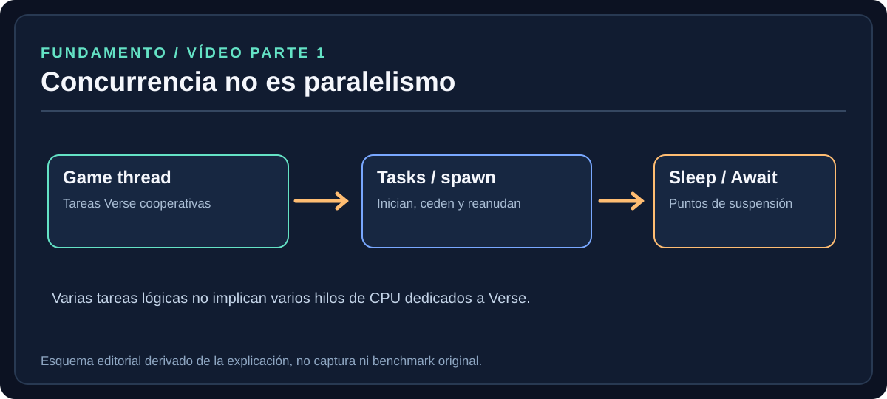
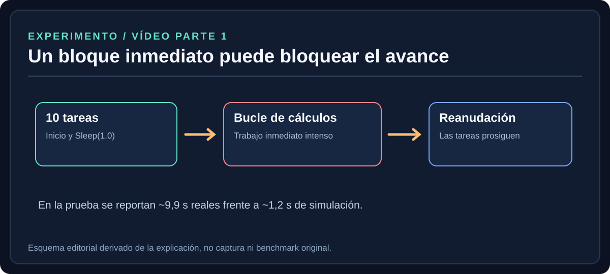
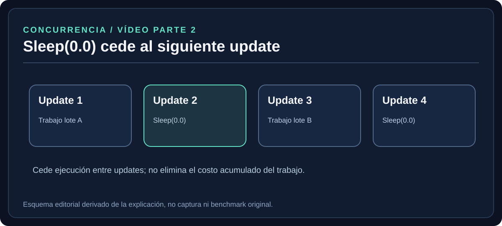
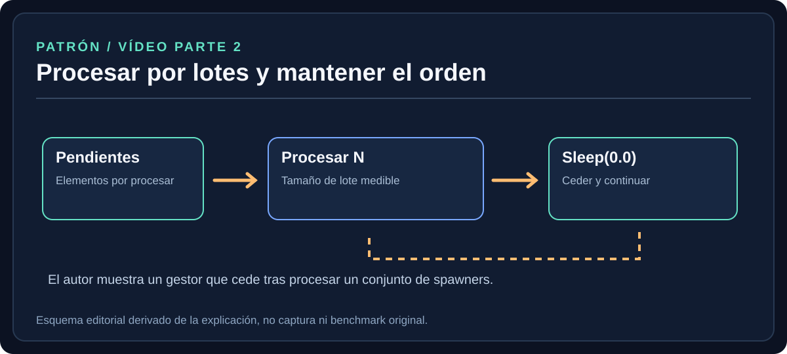
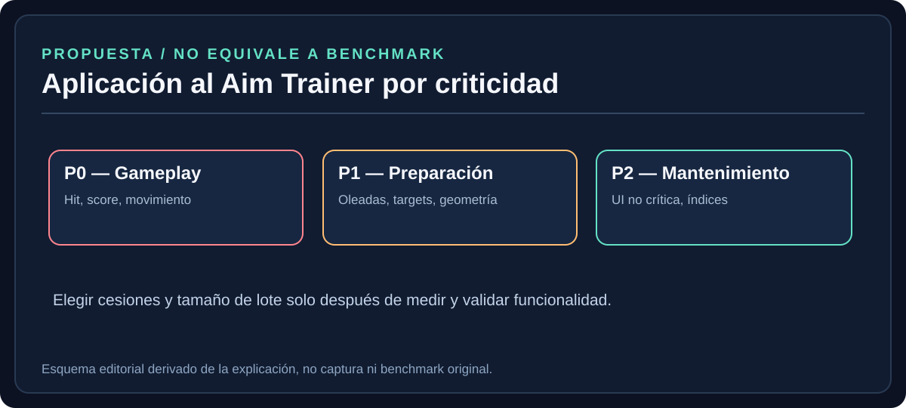

# Verse — Ticks Per Second

> **Propósito.** Documentar los principios, experimentos y consejos sobre planificación de tareas en Verse descritos por el programador Mikey Jensen en las dos partes de su serie *Verse Boost*, contrastándolos donde es posible con documentación oficial de Epic Games. Traducirlos a criterios verificables para desarrollar el Aim Trainer.
>
> **Origen y limitación.** Material base: documento `Ticks Per Seconds.docx` suministrado por el usuario (dos transcripciones con marcas de tiempo y diez capturas). **No se suministraron los enlaces directos de los videos**. Los resultados numéricos se atribuyen exclusivamente al video, no a pruebas nuevas. Las capturas originales están preservadas en el Word fuente y en el paquete complementario de materiales, pero no deben confundirse con los diagramas editoriales del directorio `assets/diagrams/`. El inventario y descripción accesible en texto se encuentran en [`assets/capture-notes.md`](../assets/capture-notes.md).

[Volver al índice del tema](../README.md) · [Inventario de imágenes](../assets/README.md) · [Notas sobre capturas](../assets/capture-notes.md)

## 0. Convención de trazabilidad

- **[VIDEO P1 mm:ss] / [VIDEO P2 mm:ss]**: afirmación o demostración del autor.
- **[EPIC]**: comportamiento documentado por Epic Games con enlace abajo.
- **[APLICACIÓN]**: criterio o recomendación de arquitectura propuesto para el Aim Trainer; sujeto a pruebas.
- **[NO VERIFICADO]**: observación insuficiente para extrapolar una regla universal.

## 1. Resumen para el agente

**Decisión principal:** cuando una tarea realiza mucho trabajo inmediato dentro de una actualización de simulación, otras tareas pueden quedar sin oportunidad de progresar. El uso intencional de funciones suspendibles y `Sleep(0.0)` permite repartir cargas *diferibles* entre actualizaciones. **Repartir carga no significa eliminarla, ni significa ejecución paralela en hilos de CPU.** [VIDEO P1 01:33–05:04; P2 00:39–02:21] [EPIC]

Epic recomienda que la carga de un frame del servidor no exceda **33,3 ms**, límite de referencia correspondiente a **30 FPS de servidor**. Es un objetivo técnico verificable y con margen para picos, no una promesa de que cada sistema de Verse se ejecute siempre a exactamente 30 TPS. [EPIC, Technical Performance in Fortnite]

**No extrapolar** el ejemplo de aproximadamente 500 cálculos `Distance`: fue una observación de la prueba concreta del autor, no una cuota fija de la API. [VIDEO P2 02:35–02:45]

## 2. Modelo de ejecución relevante



*Diagrama editorial: Concurrencia de tareas Verse frente a paralelismo. Elaboración para esta guía, no captura original del video.*


### 2.1 Concurrencia frente a paralelismo

- **Concurrencia:** varias tareas lógicas avanzan a lo largo del tiempo; pueden suspenderse y reanudarse.
- **Paralelismo:** trabajo que físicamente ocurre al mismo tiempo en distintos recursos de cómputo.
- `spawn{...}` crea/inicia una tarea asíncrona. **No permite asumir** que Verse haya creado un hilo de CPU dedicado a ella. [VIDEO P1 02:55–03:25; EPIC, Debugging and Troubleshooting]
- El autor presenta su prueba de Verse como comportamiento principalmente ejecutado en el *game thread*; esto no autoriza afirmar que **todo Unreal Engine** o **todos los subsistemas internos de UEFN** carecen de multihilo. [VIDEO P1 01:33–02:05]

### 2.2 Actualización de simulación

Una actualización (*simulation update*, *tick*) es una iteración de la simulación. Epic indica que el tiempo de simulación puede no coincidir exactamente con el tiempo real, y que una actualización no necesariamente coincide uno a uno con un frame renderizado. [EPIC, Simulation update]

**Consecuencia para código:** una expresión inmediata debe terminar en la actualización actual. Una expresión asíncrona **puede**, pero no está obligada a, extenderse a otras actualizaciones. [VIDEO P2 00:39–01:34]

## 3. Parte 1: experimento de bloqueo por trabajo inmediato



*Diagrama editorial: Secuencia conceptual de bloqueo y reanudación de tareas. Elaboración para esta guía, no captura original del video.*


### 3.1 Montaje observado

El programador inicia unas diez tareas suspendibles mediante `spawn`, utiliza una espera aproximada de un segundo en cada tarea y después ejecuta un bloque grande de cálculos `Distance` con llamadas inmediatas repetidas. [VIDEO P1 02:46–03:50]

**Secuencia conceptual (no código fuente completo):**

```text
iniciar 10 tareas con spawn
cada tarea imprime inicio -> Sleep(1.0) -> imprime final
hacer una gran cantidad de cálculos inmediatos en el mismo contexto
observar cuándo reaparecen las tareas suspendidas
```

**Pregunta experimental:** ¿las tareas suspendidas terminan mientras corre el bloque inmediato o esperan hasta que se libera el ciclo?

### 3.2 Observaciones presentadas

1. Los registros muestran los mensajes de inicio de las tareas antes del bloque masivo de cálculos.
2. Durante la carga, el autor reporta que la sesión parece congelarse y que el jugador presenta saltos o *rubber-banding*.
3. Los registros ilustran aproximadamente **9,9 segundos de tiempo real** y **1,2 segundos de simulación** para varias tareas al finalizar la prueba.
4. El bloque inmediato aparece con una duración reportada de cero para determinados valores. El autor explica que ese resultado procede de la lectura/muestreo de las funciones de tiempo, **no** de que la operación sea gratuita. [VIDEO P1 04:03–05:04]

**Interpretación correcta:** el experimento demuestra una problemática de bloqueo/avance cooperativo en ese contexto de prueba. **No** permite convertir esos tiempos en resultados universales ni probar cómo funcionan todas las operaciones internas de UEFN.

### 3.3 Qué preguntar al revisar un código similar

- ¿Existe un bucle que realiza miles de operaciones sin punto de suspensión?
- ¿La tarea principal espera datos que realmente necesitan calcularse todos ahora?
- ¿El trabajo se puede procesar en etapas sin alterar resultados visibles?
- ¿Se está midiendo tiempo real, tiempo de simulación, frame time de servidor o FPS del cliente?

## 4. Parte 2: expresiones inmediatas, async y Sleep



*Diagrama editorial: Distribución de tareas entre updates con Sleep(0.0). Elaboración para esta guía, no captura original del video.*


### 4.1 Immediate vs async

| Concepto | Significado | Ejemplos del video |
|---|---|---|
| Inmediata | Se completa en la actualización actual. | Cálculo/iteración de distancia |
| Asíncrona | Puede suspenderse y reanudarse después. | `MoveTo`, `Await`, `Sleep` |

Una operación suspendible no mejora por sí sola el costo total del algoritmo: lo que cambia es la posibilidad de distribuir el avance. [VIDEO P2 00:39–01:50]

### 4.2 Comportamientos documentados de Sleep

| Uso | Comportamiento |
|---|---|
| `Sleep(0.0)` | Cede hasta la siguiente actualización de simulación. |
| `Sleep(t)` para `t > 0` | Espera el tiempo solicitado, con las condiciones propias de la simulación. |
| `Sleep(Inf)` | Suspensión indefinida, salvo cancelación. |
| `Sleep(t)` para `t < 0` | Retorna inmediatamente sin ceder a otras expresiones asíncronas. |

La descripción oficial de Epic indica que `Sleep(0.0)` resulta útil en corrutinas repetitivas para que otras corrutinas también avancen. [EPIC, Sleep]

**Advertencia:** `Sleep()` exige un contexto apto para suspender, por ejemplo una función con `<suspends>`. No colocarlo automáticamente en funciones inmediatas o *callbacks* sin revisar sus efectos y firmas. [EPIC]

### 4.3 Preguntas de decisión del autor [VIDEO P2 01:37–01:53]

1. ¿Se necesita terminar esta expresión en la actualización actual?
2. ¿Podemos repartir la operación entre varias actualizaciones?
3. ¿Cuál es la cantidad apropiada de trabajo por actualización?

## 5. Batching y cesiones cooperativas



*Diagrama editorial: Lotes de trabajo con cesiones cooperativas. Elaboración para esta guía, no captura original del video.*


### 5.1 Patrón conceptual

```text
contador = 0
para cada elemento pendiente:
    procesar(elemento)
    contador += 1
    si contador llega al tamaño_del_lote:
        Sleep(0.0)    # exige contexto suspendible
        contador = 0
```

**Pseudocódigo de arquitectura.** No está destinado a compilarse literalmente ni reproduce la totalidad de los imports y firmas de un proyecto Verse.

Con este enfoque, la carga se distribuye en varias actualizaciones. El autor recomienda ceder con menos frecuencia en trabajo sensible a la jugabilidad y con más frecuencia en tareas secundarias. Menciona un posible planificador por prioridades como alternativa más sofisticada. [VIDEO P2 02:21–03:09]

### 5.2 Caso de estudio: gestor de spawners

En el video, un gestor recorre elementos `ManagedSpawners` y utiliza una constante equivalente a `VEHICLES_MANAGED_PER_TICK`. La demostración menciona diez vehículos por lote. El código efectúa `Sleep(0.0)` periódicamente para ceder un tick. [VIDEO P2 03:14–03:33]

**Interpretación de ingeniería:** el tamaño de lote es una **configuración medible**, no un número mágico válido para cualquier NPC, prop o cálculo.

### 5.3 Cifras de demostración y límites

- **Aproximadamente 500 llamadas a `Distance`**: ejemplo de una carga que, en la prueba del autor, redujo TPS por debajo de 30. **No** es un límite de API. [VIDEO P2 02:35–02:45]
- **Aproximadamente 3 TPS sin pausas**: cifra reportada en el tramo final de la demostración. Con cesiones, mejora visualmente; **no se documenta un valor final exacto** en el texto entregado. [VIDEO P2 03:55–04:10]
- **30 FPS de servidor / 33,3 ms por frame**: referencia documentada por Epic, útil para entender el presupuesto de servidor. [EPIC, Technical Performance]

### 5.4 Riesgos frecuentes

- Introducir `Sleep(0.0)` en medio de lógica que debe completarse de forma atómica en el mismo tick.
- Asumir que repartir trabajo reduce automáticamente el número total de instrucciones.
- Crear un número ilimitado de tareas dentro de un `loop` por medio de `spawn`; Epic presenta expresamente un ejemplo de este antipatrón que puede acabar en error en tiempo de ejecución. [EPIC, Debugging and Troubleshooting]
- Perder el orden, la sincronización, las condiciones de cancelación o el estado de salida de una tarea.
- Medir solo valores promedio, sin revisar picos y latencia visible para los jugadores.

## 6. Aplicación propuesta al Aim Trainer [APLICACIÓN]



*Diagrama editorial: Prioridades tentativas para subsistemas del Aim Trainer. Elaboración para esta guía, no captura original del video.*


Estas son hipótesis de prioridad y no resultados de profiling ni cambios ya realizados.

| Subsistema | Prioridad | Política propuesta | Qué validar |
|---|---|---|---|
| Tracking / NPC movement | **P0** | Evitar insertar cesiones en cálculos críticos sin medir. | Suavidad, movimiento, respuesta, TPS/frame time |
| Hit registration / score | **P0** | Preservar respuestas y orden en eventos. | Latencia de hit, consistencia de puntuación |
| Switching / spawn waves | **P1** | Evaluar escalonado cuando hay ráfagas grandes de inicialización. | Picos al iniciar oleadas, tiempo de aparición |
| Flickshot / posiciones de targets | **P1** | Preparar geometrías diferibles por lotes si la carga es demostrada. | Spawn correcto, geometría, retrasos |
| Playlists / setup | **P2** | Distribuir construcción no urgente de estado e índices si resulta costosa. | Tiempo de preparación vs frame time |
| UI / escenarios | **P1–P2** | Preferir cambios dirigidos por eventos en lugar de recomputación continua si es viable. | Efectos visuales, memoria, latencia |

### 6.1 Política de prioridad

- **P0, crítico de gameplay:** no insertar pausas por defecto; debe justificarse que no habrá degradación.
- **P1, preparación o trabajo acoplado a oleadas:** considerar lotes y mediciones.
- **P2, mantenimiento y trabajos tolerantes a latencia:** explorar eventos, intervalos mayores y reparto entre ticks.

### 6.2 Ejemplo de decisión

**Situación:** la selección de un escenario genera un lote grande de objetivos mientras varios NPCs ya se mueven.

1. Medir el impacto real en tiempo de frame/TPS y suavidad.
2. Separar creación indispensable para empezar de trabajo que puede prepararse por adelantado.
3. Si existe pico medido, procesar solo el trabajo diferible por lotes.
4. Validar que las condiciones de inicio, límites de targets y temporizadores de score permanezcan correctos.
5. Registrar antes/después, versión de UEFN, tamaño de lote y condiciones del escenario.

## 7. Plan de pruebas reproducible

**Antes de modificar:** capturar baseline y confirmar que el problema no sea un síntoma distinto (render del cliente, física, red, colisiones, dispositivos).

1. Fijar versión de UEFN/Fortnite y condiciones de la sesión.
2. Documentar número de jugadores, NPCs, dispositivos, escenarios simultáneos, hardware y configuración.
3. Registrar frame time promedio y p95, caídas bajo el objetivo, carga completa y respuesta de gameplay.
4. Cambiar **una** condición (tamaño de lote, frecuencia de tarea o punto de cesión) a la vez.
5. Repetir el ensayo en carga normal y estrés, con suficiente repetición para comparar.
6. Comprobar exactitud funcional: puntajes, targets, ejecución de Verse, orden de eventos, estado de tareas.
7. Guardar evidencia y revertir si reduce precisión o respuesta, aunque mejore una métrica aislada.

### 7.1 Plantilla de registro

```markdown
### OPT-XXX — [Título]
- Fecha y versión UEFN:
- Subsistema:
- Problema observado:
- Escenario de carga:
- Instrumento y métricas:
- Baseline (media / p95 / máximos):
- Hipótesis:
- Cambio (diff / referencia commit):
- Parámetros (batch size / periodicidad):
- Resultado después:
- Impacto en gameplay:
- Decisión: ACEPTAR / AJUSTAR / REVERTIR
- Fuente: [VIDEO] / [EPIC] / [APLICACIÓN]
```

## 8. Instrucciones obligatorias para el agente

1. **No afirmar que `spawn` equivale a un hilo del sistema operativo.**
2. **No inferir que Verse está aislado de cualquier hilo de motor** a partir de la demostración.
3. **No convertir los 500 cálculos `Distance` en un límite de Fortnite.**
4. **No utilizar `Sleep(0.0)` de manera automática** ni alterar lógica sensible sin aprobación técnica y medición.
5. **Identificar operaciones costosas**, distinguir las críticas de las diferibles y justificar el límite de cada lote.
6. **Mantener controlado el número de tareas** y sus condiciones de terminación/cancelación.
7. **Medir antes y después** y conservar las condiciones de prueba.
8. **Verificar requisitos de gameplay** y no aceptar una mejora técnica que empeore su precisión.
9. **Citar el origen de cada conclusión.** Marcar claramente los ejemplos inventados como pseudocódigo y las propuestas como hipótesis.
10. **No afirmar que las optimizaciones ya fueron aplicadas o compiladas** sin un resultado reproducible en el repositorio.

## 9. Índice de los videos

| Parte | Minuto | Tema |
|---|---|---|
| P1 | 00:40–01:25 | Introducción a hilos y procesos |
| P1 | 01:33–02:28 | Game thread, física y render; atasco del frame |
| P1 | 02:46–03:50 | Montaje de prueba de tareas y bucle inmediato |
| P1 | 04:03–05:04 | Congelación, logs y tiempos observados |
| P2 | 00:39–01:50 | Inmediato/asíncrono y criterios para distribuir trabajo |
| P2 | 01:55–02:21 | Definición y uso de `Sleep(0.0)` |
| P2 | 02:23–03:09 | Prioridad y ejemplo de `Distance` |
| P2 | 03:14–03:33 | Gestor de spawners y tamaño de lote |
| P2 | 03:33–04:10 | Comparación con y sin cesiones |
| P2 | 04:12–04:39 | Recomendación de 30 TPS y margen |

## 10. Fuentes y enlaces

- **Fuente primaria facilitada:** `Ticks Per Seconds.docx`; transcripción y capturas de dos videos de *Verse Boost*. Creador identificado en el propio material como **Mikey Jensen**. No se indicó enlace original, fecha de publicación ni código completo.
- **Epic Games — Sleep API:** https://dev.epicgames.com/documentation/fortnite/verse-api/versedotorg/simulation/sleep?lang=en-US
- **Epic Games — Debugging and Troubleshooting in Verse:** https://dev.epicgames.com/documentation/fortnite/debugging-and-troubleshooting-in-verse
- **Epic Games — Technical Performance in Fortnite:** https://dev.epicgames.com/documentation/fortnite/technical-performance-in-fortnite
- **Epic Games — Simulation update:** https://dev.epicgames.com/documentation/en-us/fortnite/simulation-update

## 11. Estado editorial y trabajos pendientes

- [x] Contenido de ambas partes reorganizado por conceptos.
- [x] Principales pruebas y observaciones atribuidas al autor.
- [x] `Sleep(0.0)` y 30 FPS contrastados con documentación de Epic.
- [x] Aplicaciones preliminares al Aim Trainer definidas como propuestas, no como resultados.
- [ ] Añadir URLs originales y fechas de publicación de ambas partes cuando estén disponibles.
- [ ] Recuperar código fuente íntegro del ejemplo y comprobar compilación contra la versión actual.
- [ ] Ejecutar pruebas específicas en Aim Trainer y registrar datos cuantitativos.
- [x] Incorporar cinco diagramas SVG visuales y autocontenidos al Markdown.
- [x] Documentar el contenido técnico de las capturas en texto accesible para agentes.
- [ ] Incorporar los PNG originales y el DOCX completo directamente al repositorio cuando el medio de transferencia de binarios lo permita.